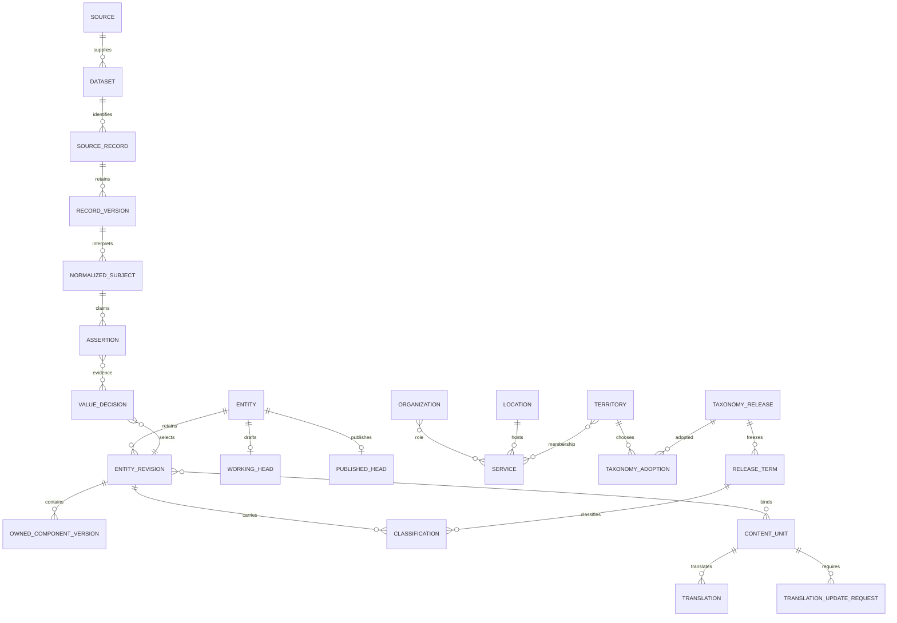

# EGI database schema proposal v0.2

Date: 2026-10-05. Status: **accepted by the user as sufficient structural basis for
specification/planning; no implementation authorization**.

Current behavior contract: [specification v1.1](specification.md).
Implementation approach: [action plan r0.2](implementation-plan.md), recording the approved approach
and environment/verification choices. Detailed SQL is not implied by structural acceptance.

This document consolidates the design interview into a relational schema proposal.
The product requirements below are selected. Exact tables, columns, types, indexes
and implementation mechanisms are recommendations to review, not deployed DDL.
PostgreSQL is authoritative, PostGIS provides spatial operations, `psql` is the
client and Sqitch will manage structure. Population/bootstrap is separate work.

Evidence and the full decision ledger remain in
[canonical-database.md](canonical-database.md). Earlier application routes, ORM
and source findings are in [api-and-data-inventory.md](api-and-data-inventory.md).
The existing app is a reference, not an endpoint compatibility requirement.

## 1. Selected boundaries

- A service is a distinct offer at a place/area. Similar offers in different places
  have distinct IDs; shared organizations and classifications connect them.
- A place can host multiple services, from different organizations and categories.
  Host/operator responsibility does not imply responsibility for every service.
- A genuine relocation preserves the service ID and history. Simultaneous offers
  at different places remain distinct. Telephone/online delivery needs no fake point.
- Sources, original claims, conflicts, interpretations and accountable selections
  survive reprocessing, editorial changes and restores.
- First publication and subsequent changes need approval. Incomplete records remain
  in draft. An approved public version coexists with pending edits.
- Revision history and restoration cover services, places, organizations and their
  schedules/contacts/access/relationships. A restore creates a new revision.
- Hours are relational, with table display, open-now and closing-time calculations.
  Unknown is distinct from closed. One shared exception calendar initially supports
  advisories and confirmed changes; advisories invite contact by default.
- Taxonomy is adopted per territory; shared vocabularies or independent local copies
  are allowed. Terms support several broader parents without cycles. Filters include
  descendants, use OR within an axis and AND between axes, without duplicate services.
- UI language catalogs belong to the app and work across territories. `i18n` stores
  dynamic, partial translations, their originals and work needed to update them.
  Translation languages/priorities differ by territory. Each missing current
  translation falls back to the original field. Writing direction follows language;
  mixed content does not change the established UI layout direction.
- Permanently closed services remain accessible by direct link but leave ordinary
  discovery. Aging information stays visible with a needs-reconfirmation warning.
- Public locations are non-confidential in the current scope. Organization
  self-service, privileged urgent warnings and transit enrichments are deferred.

## 2. Namespaces and authority

| Schema | Responsibility | Initial scope |
| --- | --- | --- |
| `data` | Entity identity and typed service/organization/location content, contacts, hours and access | MVP |
| `sources` | Source registry, captures, immutable records, normalized subjects and assertions | MVP |
| `governance` | Actors, territory permissions, review, publication, resolution and value selection | MVP |
| `audit` | Append-only actions and public change sequence | MVP |
| `geo` | Territorial identity/boundaries, membership, coverage, geocoding evidence | MVP, geocoder provider later |
| `taxonomy` | Vocabularies, frozen releases, terms, hierarchy and territorial adoption | Structure MVP; vocabulary separate task |
| `i18n` | Language metadata, original text units, translations, local priorities and update queue | MVP dynamic content only |
| `api` | Explicit approved public views and export contracts | MVP public reads; exporters later |
| `derived` | Reproducible stored computation results | Future namespace, no initial transport tables/jobs |

There are no duplicate `draft.services` and `active.services` authorities. Draft and
public are logical workspaces over one entity identity and retained revisions.
`published` describes editorial publication; `active` describes operational status.

## 3. Identity, types and common conventions

Propose UUID identifiers, stable across imports, territories and SQLite snapshots.
The UUID generation choice is an implementation detail; HSDS export IDs can use the
same UUIDs. Legacy integer IDs are optional explicit aliases, never numeric casts.

In the tables below, `id`/`*_id` denote `uuid`; revision numbers are `bigint`;
instants are `timestamptz`, civil dates `date`, local times `time without time zone`,
codes/labels `text`, booleans `boolean`, distances `double precision` in meters.
Core classifications/status codes use checked text or reference tables, not
territory-specific PostgreSQL enum definitions. Latitude/longitude are scalar
`double precision` WGS84 values; geometry is explicitly derived.

Technical defaults can include generated UUIDs, creation timestamps and draft
state. Semantic defaults cannot silently claim free access, confirmed opening,
known cost, verification or a provider not established by evidence.

`revision_id` identifies an immutable saved entity revision. Child collections are
stored against it. Stable component IDs distinguish the same logical contact,
schedule or condition across successive revisions; a missing component in a new
revision means removal from that version, not deletion of its history.

### Identity and revision tables

| Table | Proposed key and principal columns | Contract |
| --- | --- | --- |
| `data.entities` | PK `entity_id`; `entity_kind`, `created_at`, `retired_at?` | Kinds: organization, location, service, territory, taxonomy_vocabulary, taxonomy_term, calendar_event. Stable identity, not an EAV payload. |
| `data.organizations` | PK/FK `entity_id` | Typed identity; content in organization revisions. |
| `data.locations` | PK/FK `entity_id` | Typed place identity, reusable by several services. |
| `data.services` | PK/FK `entity_id` | Typed offer identity; no required organization or physical point at ingestion. |
| `data.components` | PK `component_id`; FK `owner_entity_id`; `component_kind` | Stable owned identity for contacts, schedules, rules, conditions and relation entries. Do not transfer ownership by editing an ID. |
| `governance.entity_revisions` | PK `revision_id`; FK `entity_id`; `entity_kind`, `revision_number`, `parent_revision_id?`, `restored_from_revision_id?`, `actor_id`, `reason`, `created_at` | UNIQUE `(entity_id, revision_number)`; typed payload and related collections form one saved version. Parents/restores belong to the same entity. |
| `governance.working_heads` | PK/FK `entity_id`; FK `revision_id` | Current draft workspace head. It can differ from the approved public head. |
| `governance.publications` | PK `publication_id`; FK `entity_id`, `revision_id`, `review_decision_id`, `actor_id`; `published_at`, `action`, `previous_publication_id?` | Immutable approve/publish/withdraw history. A withdrawal is explicit; closure alone is not withdrawal. |
| `governance.published_heads` | PK/FK `entity_id`; FK `publication_id`, `revision_id` | Current approved public head, updated atomically with publication/audit. |

Use composite FKs or equivalent integrity enforcement to ensure typed identity,
revision/entity ownership, component ownership and referenced publication agree.
UUID alone is insufficient to establish the target's type. Published revisions
cannot be edited in place. Draft editing saves new revisions, then advances its head.

## 4. Services, organizations, places and relationships

Translatable text references `i18n.content_units` instead of duplicating editable
original text in translation rows. Names and descriptions remain explicit typed
fields; the API resolves their original units and requested translations.

| Table | Principal columns beyond key | Relationships/meaning |
| --- | --- | --- |
| `data.organization_revisions` | PK/FK `revision_id`; `entity_id`, `name_content_id`, `description_content_id?`, `organization_type?`, `website?`, `operational_status?` | One typed payload per org revision. A provider description may be unknown in EGI. |
| `data.location_revisions` | PK/FK `revision_id`; `entity_id`, `name_content_id?`, `location_kind`, `latitude?`, `longitude?`, `coordinate_state`, `coordinate_decision_id?`, `selected_geocoding_result_id?`, `parent_location_id?` | Known physical site; hierarchy reserves entrances/rooms without requiring them now. Coordinates both present or absent. |
| `data.service_revisions` | PK/FK `revision_id`; `entity_id`, `name_content_id?`, `description_content_id?`, `delivery_mode`, `operational_status`, `cost_state`, `cost_note_content_id?`, `valid_from?`, `valid_until?`, `closure_date?`, `closure_reason_content_id?` | Drafts can lack publication-required fields. Status: active/inactive/temporarily_closed/defunct/unknown. Costs: free/paid/variable/unknown. |
| `data.service_places` | PK `(revision_id, component_id)`; `location_id?`, `territory_revision_id?`, `area_description_content_id?`, `effective_from?`, `effective_until?`, `value_decision_id` | One current place/area context per place-specific service. Choose exactly one location or area context; precise historical association belongs to each service revision. |
| `data.service_organizations` | PK `(revision_id, component_id)`; `organization_id`, `role_code`, `effective_from?`, `effective_until?`, `value_decision_id` | Many organizations per service; manager/delivery_partner distinct from funder/supporter. Final role vocabulary separate data. |
| `data.location_organizations` | PK `(revision_id, component_id)`; `organization_id`, `role_code`, `value_decision_id` | Host/operator relationships, independent of service responsibility. |
| `data.addresses` | PK `(revision_id, component_id)`; `address_kind`, `line1?`, `line2?`, `locality?`, `postal_code?`, `administrative_area?`, `country_code?`, `formatted`, `normalized_form?`, `normalization_state`, `value_decision_id` | Structured canonical presentation; raw conflicting addresses remain source assertions. Location owns physical addresses. |
| `data.service_languages` | PK `(revision_id, language_code, availability_kind)`; `note_content_id?`, `value_decision_id` | Languages spoken/interpreted by the actual service, not its UI/content translation languages. |

Recommend one primary delivery mode per record initially: `in_person`, `telephone`,
`online`, `itinerant`. Ancillary contact channels do not change the service mode.
Genuinely mixed delivery can be an explicit later extension; no forced invented place.
The exact availability of mode combinations is a proposal to inspect with real data.

For a move, a new service revision changes its place association. Never alter the
old shared location's coordinates to simulate relocation. Other services there remain
unchanged. A location correction is separately versioned/approved.

Example, using the user's examples as illustrations rather than verified records:

```text
Sant'Egidio ── manages ── service A ── delivered at ── Castrense
Sant'Egidio ── manages ── service B ── delivered at ── Tuscolano

shared facility ── hosts ── healthcare service ── provider organization 1
                └─ hosts ── legal advice       ── provider organization 2
```

No uniqueness constraint on `(location, category)` or `(location, organization)`:
distinct offers can share both. Names/proximity are matching evidence, not identity keys.

### Logical ER overview



The simplified `LOCATION`/`SERVICE` cardinality represents the current physical
place; remote services and area-valued itinerants use their explicit alternate
context. Historical moves live in service revisions, not several simultaneous
current locations under one service ID. Revision child tables preserve component IDs.

## 5. Contact and access records

| Table | Principal columns | Contract |
| --- | --- | --- |
| `data.contact_entries` | PK `(revision_id, component_id)`; `channel_type`, `value`, `normalized_value?`, `purpose_code?`, `label_content_id?`, `sort_order`, `availability_schedule_id?`, `value_decision_id` | Owned by service/location/org revision. Channel phone/email/web/WhatsApp/etc. is distinct from scope and purpose. |
| `data.service_contact_links` | PK `(revision_id, component_id)`; `target_entity_id`, `target_contact_component_id`, `purpose_code?`, `label_content_id?`, `value_decision_id` | Explicitly reuse relevant org/location contacts. Public resolution uses the target's approved revision; no unrestricted dump of all organization contacts. |
| `data.access_conditions` | PK `(revision_id, component_id)`; `condition_kind`, `requirement_state`, `details_content_id?`, `value_decision_id` | Kind: appointment/referral/document/eligibility/other; state required/not_required/conditional/unknown. Preserve original wording and evidence. |

Access is separate from calendar opening. Multiple conditions are displayed without
assuming they are an AND expression for automated legal/eligibility decisions.
Advanced expressions/eligibility matching are future work; an audience classification
does not automatically mean everyone else is excluded.

Appointment required does not mean closed. An unknown charge does not mean free.
Contact inheritance is expressed through labelled relevant links, not by silently
copying a provider number onto each service. The API reports actual scope, channel
and purpose. Endpoint normalization does not alone deduplicate distinct purposes.

## 6. Relational hours and shared exception calendar

Choose individual ISO weekdays (1 Monday through 7 Sunday) for the first physical
proposal. A bitmask is unnecessary for canonical storage; grouping for display can
be derived. This is a technical recommendation following the selected interval table.

| Table | Principal columns | Contract |
| --- | --- | --- |
| `data.schedules` | PK `(revision_id, component_id)`; `scope_code`, `timezone_name`, `effective_from?`, `effective_until?`, `description_content_id?`, `completeness`, `value_decision_id` | Service/intake/contact scope. IANA timezone such as Europe/Rome, not only a numeric UTC offset. |
| `data.schedule_days` | PK `(revision_id, schedule_id, weekday)`; `day_state`, `completeness` | States intervals/closed/unknown. Missing days mean unknown. Partial declarations remain partial. |
| `data.schedule_intervals` | PK `(revision_id, component_id)`; `schedule_id`, `weekday`, `opens_at`, `closes_at`, `end_day_offset`, `value_decision_id` | Several intervals per day; offset 0 or 1 in the initial simple weekly model. Empty interval forbidden. 24h represented explicitly through next-day end. |
| `governance.exception_calendars` | PK `calendar_id`; `code`, `name`, `scope_territory_id?`, `created_at` | One shared calendar initially; registry can later support org calendars without a singleton DDL constraint. |
| `governance.calendar_event_versions` | PK/FK `revision_id` (event version); FK `event_id` to typed entity identity; `calendar_id`, `supersedes_id?`, `date_from`, `date_until`, `event_kind`, `reason_content_id?`, `actor_id`, `created_at` | Kind advisory/confirmed_change. Use the common entity revision/publication heads for calendar events; public/pending changes remain separate. |
| `data.schedule_calendar_links` | PK `(revision_id, schedule_id, calendar_id)`; `applicability` | Explicit calendar adoption and geographical applicability. Default shared calendar advisory is not a universal closure. |
| `data.schedule_exception_effects` | PK `(revision_id, component_id)`; `schedule_id`, `event_version_id`, `effect_kind`, `value_decision_id` | Effect closed/replace/add; confirmed replacement intervals are separate typed child rows, not a JSON hours blob. |
| `data.exception_intervals` | PK `(revision_id, component_id)`; `effect_id`, `opens_at`, `closes_at`, `end_day_offset`, `value_decision_id` | Typed intervals for confirmed replacement/add effects; owned by the same entity revision as the effect. |

Calendar event approval uses the common review/publication workflow. Event reasons
can use original content units owned by their calendar-event identity/revision.
Recurrence beyond simple weekly/date windows
stays retained as evidence until an explicit supported interpretation is available.

Evaluation recommendation:

1. Resolve the approved subject/scope and effective schedule for the requested date.
2. Apply only applicable approved confirmed changes; conflicting effects yield
   unknown plus review work, not last-write-wins.
3. Apply advisory warnings independently. Regular hours can be shown as baseline;
   uncertain exceptions must not promise a confirmed closing countdown.
4. Resolve local intervals including previous-day spillover to dated instants;
   use half-open intervals and merge contiguous periods of the same applicable scope.
5. Return opening status, certainty, timezone, basis and next transition. Missing/
   conflicting data yields unknown. 24/7 may have no known closing transition.

Advisories say hours may vary and invite contact. Confirmed closures/replacements
need evidence. Week-table rendering and open-now use the same rules; itinerant
places remain visible on non-operating days, each with its own schedule.

DST gaps/overlaps need an explicit conservative evaluator policy before implementation;
do not silently guess from naive time comparisons. PostgreSQL stores instants in
`timestamptz`, not the original named zone.
[PostgreSQL datetime](https://www.postgresql.org/docs/current/datatype-datetime.html).

## 7. Sources, normalization and repeat processing

| Table | Principal columns | Contract |
| --- | --- | --- |
| `sources.registry` | PK `source_id`; `code`, `name`, `publisher?`, `homepage?`, `source_kind`, `license?`, `attribution?`, `retrieval_policy?` | Source identity and current metadata; snapshot attribution/license/resource identity on captures for historical reproducibility. Secrets are not registry payloads. |
| `sources.datasets` | PK `dataset_id`; `source_id`, `external_key?`, `name`, `resource_url?`, `version_hint?` | A publisher can supply multiple datasets. |
| `sources.captures` | PK `capture_id`; `dataset_id`, `retrieved_at`, `published_at?`, `artifact_uri`, `content_hash`, `media_type`, `retrieval_status`, `source_metadata_snapshot` | Repeated observations retained even when bytes do not change. Immutable artifact/hash reference. |
| `sources.records` | PK `record_id`; `dataset_id`, `external_key?`, `generated_locator?`, `identity_method` | Unique upstream key within dataset when present; generated locators are not falsely labelled upstream IDs. |
| `sources.record_versions` | PK `record_version_id`; `record_id`, `content_hash`, `raw_payload?`, `artifact_locator?`, `observed_at?` | Immutable version; enforce at least one recoverable evidence representation. |
| `sources.capture_records` | PK `(capture_id, record_version_id)`; `row_page_feature_locator` | Observations link captures to reused record versions. |
| `sources.processing_runs` | PK `run_id`; `run_kind`, `parent_run_id?`, `capture_id?`, `processor_version`, `config_hash`, `started_at`, `finished_at?`, `status` | Normalize/match/geocode jobs reproducible from input and versions. |
| `sources.normalized_subjects` | PK `subject_id`; `record_version_id`, `run_id`, `subject_kind`, `subject_locator`, `normalized_payload` | One raw row can yield several org/place/service/contact subjects. This JSON is interpretation evidence, not canonical EAV content. |
| `sources.assertions` | PK `assertion_id`; `subject_id`, `attribute_code`, `raw_value?`, `normalized_value`, `language_code?`, `scope?`, `valid_from?`, `valid_until?`, `certainty`, `method` | Conflicting scalar/collection/negative claims retained; absence/unknown/explicit empty differ. |

Raw records are not deleted when parsing fails or a public record is incomplete.
Source disappearance does not imply service closure. Changed algorithms create new
interpretations and candidates; they do not overwrite approved public selections.
Geocoding can occur after entity resolution. Manual corrections are accountable
manual-source assertions, not evidence-free edits.

## 8. Resolution, value selection, review and publication

| Table | Principal columns | Contract |
| --- | --- | --- |
| `governance.actors` | PK `actor_id`; `actor_kind`, `external_identity?`, `display_name?`, `active` | Human/system/import identity for accountability; app authentication/password storage not selected here. |
| `governance.actor_grants` | PK `grant_id`; `actor_id`, `capability`, `territory_id?`, `valid_from?`, `valid_until?`, `granted_by` | Capabilities propose/approve/publish; null scope explicitly denotes global permission, not missing territory. Self-approval allowed only by explicit policy. |
| `governance.submissions` | PK `submission_id`; `entity_id?`, `proposed_revision_id?`, `base_revision_id?`, `territory_id?`, `actor_id`, `status`, `submitted_at`, `note?` | Create/update/restore proposals, stale-base/conflict checks and needs-changes. |
| `governance.review_decisions` | PK `decision_id`; `submission_id?`, `target_revision_id?`, `translation_id?`, `taxonomy_adoption_id?`, `taxonomy_release_id?`, `outcome`, `actor_id`, `decided_at`, `reason` | Explicit typed review targets; exactly one target for an actionable approval. |
| `governance.verifications` | PK `verification_id`; `entity_id`, `revision_id`, `field_code?`, `component_id?`, `scope_kind`, `actor_id`, `checked_at`, `method`, `evidence_ref`, `outcome` | Whole page or individual content; import/edit date is not verification. |
| `governance.match_candidates` | PK `candidate_id`; `run_id`, `subject_id`, `entity_id`, `score?`, `features`, `status` | Suggestions are not accepted identities; algorithm/version comes from run. |
| `governance.resolution_decisions` | PK `decision_id`; `operation`, `actor_id`, `run_id?`, `reason`, `decided_at`, `previous_decision_id?` | Link/unlink/merge/split; typed affected identities/subjects held in child membership tables. |
| `governance.resolution_members` | PK `(decision_id, subject_id, entity_id, member_role)` | Durable participants and before/after intent for reversible decisions. |
| `governance.subject_bindings` | PK `(subject_id, entity_id)`; `decision_id`, `binding_state` | Current accepted association derived from decision history, with typed subject/entity compatibility. |
| `governance.value_decisions` | PK `value_decision_id`; `revision_id`, `field_code`, `component_id?`, `selection_kind`, `policy_version?`, `actor_id`, `reason`, `decided_at` | Select/compose/unresolved decisions per attribute/collection, including negative claims. |
| `governance.value_evidence` | PK `(value_decision_id, assertion_id, evidence_role)` | Supporting/contradicting evidence; several sources can support one selected value. |
| `governance.identity_aliases` | PK `alias_id`; `old_entity_id`, `current_entity_id?`, `decision_id`, `alias_kind` | Merge redirects and tombstones; split/restore repair is explicit, not arbitrary reassignment. |

Publication validation checks name, meaningful description, delivery mode, source
evidence and editorial approval. Telephone/online offers require a usable access
channel; in-person offers require identifiable location/access directions, not
necessarily coordinates. Known hours/organization are not universal requirements.
Itinerant area descriptions remain usable when no exact stop is known.

Structural validity is enforced even for drafts; publication completeness is a
separate validator. Approval records the exact revision/covered components. Validation
results should be available as a structured diagnostic list on submissions; propose
`governance.validation_results` with target revision, validator version, code,
severity, field/component and message, rerun on the reviewed revision.

Restore copies the selected earlier aggregate into a new revision, records its
origin and actor, and repeats validation/review. Referenced shared entities retain
their independently approved current heads; there is no implicit cascade restore.
Restoring old content does not manufacture a fresh verification of real conditions.

Authorization must cover all affected territories for shared-entity changes; merely
being the last UI-selected territory cannot grant global edit authority. Exact
cross-territory escalation is a proposed implementation policy to review.

## 9. Geography, territorial membership and geocoding

| Table | Principal columns | Contract |
| --- | --- | --- |
| `geo.territories` | PK/FK `entity_id`; `code` | Map/editorial territory identity, independent of administrative country/region boundaries. |
| `geo.territory_revisions` | PK/FK `revision_id`; `entity_id`, `name_content_id`, `country_code?`, `timezone_name`, `boundary?`, `boundary_source_id?`, `center_latitude?`, `center_longitude?`, `default_zoom?` | Polygon/MultiPolygon WGS84 when known; a UI center is not a service location. |
| `geo.service_memberships` | PK `(revision_id, territory_id)`; `membership_reason`, `value_decision_id` | Same service can appear in overlapping territories with the same ID. |
| `geo.service_coverage` | PK `(revision_id, component_id)`; `territory_id?`, `geometry?`, `description_content_id?`, `value_decision_id` | Reach/eligibility area, distinct from map membership and physical delivery point. |
| `geo.geocoding_results` | PK `result_id`; `run_id`, `provider`, `provider_version?`, `request_hash`, `input_address`, `context`, `latitude?`, `longitude?`, `normalized_address?`, `precision`, `native_score?`, `status`, `retrieved_at`, `payload_ref` | Keep competing/failed provider results. Provider scores are not comparable by default. |
| `geo.geocoding_cache` | PK `cache_key`; `provider`, `request_hash`, `context_hash`, `result_id`, `expires_at?` | Derived reuse index; provider/config/context participate in key. Negative-result expiry explicit. |

Canonical scalar coordinates drive derived `geometry(Point,4326)` through a future
verified mechanism. Never edit scalar and geometry independently. Latitude/longitude
order is explicit; GeoJSON uses longitude/latitude. Metric distances require geography
or an appropriate projected CRS, not raw degree distances. No invented centroid
for a coarse itinerant area. Geocoder licensing/provider selection is deferred.

## 10. Territorial taxonomy

| Table | Principal columns | Contract |
| --- | --- | --- |
| `taxonomy.vocabularies` | PK/FK `entity_id`; `code`, `origin_vocabulary_id?`, `origin_release_id?` | Shared vocabulary or independent copy with distinct identity. |
| `taxonomy.vocabulary_revisions` | PK/FK `revision_id`; `entity_id`, `name_content_id`, `description_content_id?` | Versioned metadata. |
| `taxonomy.axes` | PK `axis_id`; `vocabulary_id`, `code` | Need/service_type/population_access etc. are data, not fixed category columns. |
| `taxonomy.terms` | PK/FK `entity_id`; `vocabulary_id`, `axis_id`, `code`, `external_uri?` | UNIQUE code within vocabulary/axis; same label in two vocabularies does not mean same identity. |
| `taxonomy.term_revisions` | PK/FK `revision_id`; `entity_id`, `label_content_id`, `description_content_id?`, `active`, `presentation_metadata?` | Label/icon/color are versioned vocabulary/presentation data. |
| `taxonomy.releases` | PK `release_id`; `vocabulary_id`, `vocabulary_revision_id`, `version`, `approved_by`, `published_at` | Frozen coherent vocabulary snapshot; pending term edits do not leak. |
| `taxonomy.release_axes` | PK `(release_id, axis_id)`; `label_content_id`, `sort_order` | Frozen axis presentation; original label belongs to vocabulary revision content. |
| `taxonomy.release_terms` | PK `(release_id, term_id)`; `term_revision_id` | Exact approved term versions. |
| `taxonomy.broader_links` | PK `(release_id, child_term_id, parent_term_id)` | Both terms in same release/axis; multiple parents, no cycles. |
| `taxonomy.territory_adoptions` | PK `adoption_id`; `territory_id`, `vocabulary_id`, `release_id`, `effective_from`, `effective_until?`, `review_decision_id` | Explicit pinned local adoption; reject overlapping conflicting active adoptions for the same axis scope. |
| `taxonomy.assignments` | PK `(service_revision_id, adoption_id, term_id)`; `release_id`, `value_decision_id` | Territorial classification; composite FKs bind adoption/release and released term, not an implicit global category. |
| `taxonomy.term_mappings` | PK `mapping_id`; `source_release_id`, `source_term_id`, `target_release_id`, `target_term_id`, `mapping_kind`, `evidence_ref`, `approved_by` | Optional explicit exact/broader/narrower/related correspondence, not guessed equivalence. |

A local copy starts from a known source release but does not auto-sync or mutate it.
Publication of a new shared vocabulary release does not automatically change every
territory's pinned adoption. Migrate/validate assignments when explicitly adopting
a new release; historical service revisions retain their original classification context.

Search expands descendants in the selected territory/release/axis, ORs selections
within that axis, ANDs axes and deduplicates service IDs. Query expansion does not
create canonical assignments or infer eligibility. Offline uses the same frozen
hierarchy/assignments; recursive evaluation or a derived closure index is a later
implementation choice. The detailed vocabulary is outside this proposal.

## 11. Dynamic i18n and translation update queue

| Table | Principal columns | Contract |
| --- | --- | --- |
| `i18n.languages` | PK `language_code`; `native_name`, `english_name`, `direction` | Language-tag registry; ltr/rtl metadata. Not a territorial UI-language allowlist. |
| `i18n.content_units` | PK `content_id`; `owner_entity_id`, `introduced_revision_id`, `field_code`, `component_id?`, `original_language?`, `original_text`, `content_hash`, `value_decision_id?` | First-class original fragment for a typed name/description/note/label. Immutable, owned by a stable entity/field/component and introduced by a known revision. |
| `i18n.revision_content_links` | PK `(revision_id, field_code, component_scope)`; `content_id` | Explicit binding of a typed revision field to its original unit; allow reuse of unchanged originals across revisions of the same entity. |
| `i18n.translations` | PK `translation_id`; `content_id`, `language_code`, `text`, `translation_class`, `generated_by?`, `model_version?`, `reviewed_by?`, `reviewed_at?`, `created_at`, `supersedes_id?` | Immutable candidate versions: human/ai/ai_verified. Preserve generation origin even after verification. |
| `i18n.translation_publications` | PK `publication_id`; `content_id`, `language_code`, `translation_id`, `review_decision_id`, `published_at` | Approved current choice per original fragment/language, distinct from linguistic verification. |
| `i18n.territory_language_priorities` | PK `(territory_id, language_code)`; `priority`, `enabled_for_translation_work` | Target/prioritized dynamic content languages; does not restrict globally available UI languages. |
| `i18n.translation_update_requests` | PK `request_id`; `entity_id`, `field_code`, `component_id?`, `language_code`, `required_content_id`, `previous_translation_id?`, `reason`, `status`, `created_at`, `resolved_translation_id?` | Visible work queue for changed originals; duplicate open work avoided, newer requirements supersede stale work. |

Propose a language code capable of BCP 47 tags instead of a short two-character enum.
Original language can be unknown without guessing Italian. Content-unit owner/type,
field registry and component ownership must agree. For unchanged field text/language,
preserve translation applicability through an explicit retained origin link/content
identity; do not invalidate every translation merely because another field changed.
Use `i18n.revision_content_links` to bind unchanged units to later revisions of the
same owning entity. Typed name/description/note FKs must agree with these bindings.
`component_scope` is a non-null owner-local root-or-component key with a checked
relation to `data.components`; exact root representation is an implementation detail.
Do not regenerate content IDs for every save. A previously published field/unit can
be reused after a restore, but that reuse does not constitute a new linguistic check.

Only when changed originals are approved/public do affected old translations leave
normal current responses. Retain history, fall back per field and create update work.
Unchanged fields keep approved translations. A generated translation alone cannot
clear the request; publication must match the current original. Existing applicable
translations may be used even when the language is not locally prioritized.

UI catalogs/preferences/layout live in the app. A mixed Arabic/Italian page retains
the selected UI direction while individual text fragments expose actual language/
direction for correct rendering. There is no automatic cross-territory duplicate
translation solely because work priority differs.

## 12. Audit, public views and application contract

| Table/view | Proposed information | Purpose |
| --- | --- | --- |
| `audit.events` | PK `event_id`; `actor_id`, `action`, `entity_id?`, `revision_id?`, `decision_id?`, `run_id?`, `occurred_at`, `details` | Append-only editorial/processing/publication/restore record; JSON details are diagnostics, not sole canonical history. |
| `audit.public_changes` | Monotonic `change_sequence`; `entity_id`, `publication_id`, `resource_kind`, `changed_at`, `reason` | Related changes invalidate public service responses and export revisions. |
| `api.published_services` | Approved service/location/org selections, base original fields, delivery/operational/publication states, territory membership | Internal DB view contract; request-language projection belongs to read service, not a writable second authority. |
| `api.service_details` | Relevant labelled contacts, access, hours, source attribution, verification/freshness and localized field metadata | Direct access can include defunct services clearly labelled closed. |
| `api.discoverable_services` | Published service records excluding defunct by default | List/map/category filtering; itinerants remain visible on non-operating days. |
| `api.public_taxonomy`, `api.public_territories` | Selected territory configuration, pinned taxonomy releases, labels/direction | More than one active area supported. |
| `api.export_manifests` | `export_id`, `format`, `snapshot_sequence`, `schema_version`, `policy_version`, `territories`, `languages`, `created_at`, `checksum?`, `status` | Export lineage; creation is a future exporter responsibility. |

Freshness warnings derive from scoped verification plus versioned review-policy
thresholds, not merely row updated_at. Threshold values are not selected. A missing
verification is reported as unverified; an old verification is retained as historical
rather than silently cleared. Invalid/removed shared contact references need explicit
validation or omission with diagnostics, not fallback to a pending contact revision.

Public reads cannot traverse working heads or unapproved shared contacts/org/location
revisions. Use a consistent transaction snapshot when assembling related heads.
Publication updates and public sequence advance atomically. A separately approved
shared location correction may legitimately affect several service views; invalidate
each affected resource without claiming their service payloads were directly edited.

Suggested API capabilities, not a mandatory reproduction of old routes:
territory discovery, territory taxonomy, service search/detail, map viewport,
language preference, category-axis filters, delivery mode and explicit open-now filter.
Responses expose service ID, place/area identity, actual field language, opening
basis/uncertainty, labelled contacts, access and sanitized sources. Known UI languages
remain globally available from the app catalog.

Operational unknown and schedule unknown remain separate from editorial draft.
Temporarily closed discovery behavior and exact pagination/search syntax can be
specified by the application contract; they do not block this relational proposal.

## 13. HSDS compatibility and required-field defaults

Reference: HSDS 3.3.1, eventually pinned by the exporter. JSON and tabular constraints
differ; this DB does not pretend to implement the full HSDS API protocol.

| EGI concept | HSDS projection | Adaptation |
| --- | --- | --- |
| Organization revisions | organization | Name/description, public channels and stable ID. |
| Place-specific service revisions | service | Separate service IDs at separate places; description/cost/access/languages mapped. |
| Location + approved service place link | location + service_at_location | Physical points/addresses only where applicable; no forced point for remote offers. |
| Relational schedule rules | operating_hours / events | Explicit recurrence/date/timezone conversion; no dump of internal schedule tables. |
| Territorial taxonomy release/assignments | taxonomy/term/attribute concepts | Retain vocabulary identity/URI and scoped classification provenance. |
| Multi-org roles | Responsible organization designation plus applicable supported metadata/extensions | Never choose a funder as provider merely to fill a field. |
| Governance/internal lineage | Selected metadata/public attribution subset | No exposure of raw records, private actors or internal conflicts. |

The user selects required-field defaults where appropriate and exclusion of records
that remain invalid. Exclusion means from the conforming output, with diagnostics;
it never deletes source/draft/history. Most essential service publication requirements
are already enforced in EGI; do not assume all export-invalid records are invalid EGI.

Propose versioned `api.export_default_policies` data/config: profile/field,
missing-value condition, default kind/value, reason and policy version. Export run
diagnostics record which defaults were applied. This is projection behavior, not
rewriting canonical source facts.

| Required-field case | Proposed handling |
| --- | --- |
| Export identifier absent | Stable generated/export-mapped UUID, not random on each run. |
| Service name absent | Fails EGI publication validation; stays draft. No fabricated offer name. |
| Organization description absent | An explicit textual default such as “Description not available” may be allowed by the policy and traced as a default. |
| Responsible organization unknown | Preserve uncertainty. A clearly labelled export-only unresolved-provider placeholder is an option requiring explicit profile policy; it must never masquerade as a known real organization. Otherwise diagnostic/exclusion where linkage is required. |
| Operational status unknown | HSDS lacks unknown in its service status enum. Do not equate published with active; use an evidence-backed mapping, otherwise diagnostic/exclusion. |
| Hours/coordinates absent | Not by itself an invalid HSDS service; omit unavailable optional data. |
| Required type/format/FK broken | Convert deterministically when possible; otherwise fail validation and report. |

These specific default recipes are proposed, not separately selected factual rules.
The exporter must validate the produced objects/package after defaults, preserve
referential closure and report invalid records/defaults without inventing certainty.
Selecting JSON versus tabular and exact placeholder policy belongs to exporter review.

Official service schema requires id/name/status; organization_id is additionally
tabular-required. Organization schema requires id/name/description. Service statuses
are active/inactive/defunct/temporarily closed. Required-field checks differ from a
field marked “core” in explanatory schema metadata.
[Service schema](https://raw.githubusercontent.com/openreferral/specification/v3.3.1/schema/service.json),
[organization schema](https://raw.githubusercontent.com/openreferral/specification/v3.3.1/schema/organization.json),
[HSDS reference](https://docs.openreferral.org/en/v3.3.1/hsds/schema_reference.html).

## 14. PostgreSQL/PostGIS and SQLite distribution

PostgreSQL owns relational constraints, publication transactions, JSONB evidence,
geospatial derivations, hierarchy checks and processing history. SQLite is a
read-only projection; the authority boundary is already recorded in
[ADR 0001](../adr/0001-canonical-database-and-offline-distribution.md).

Propose territory snapshots containing latest approved public service/place/org
content, relevant contacts/access/hours, selected calendar events, frozen taxonomy,
available approved current translations, field-language/direction metadata and
sanitized source/verification information. Preserve permanently closed-service
direct-access data but exclude it from default discovery. No drafts, raw evidence,
credentials or full editorial revision history.

Flatten namespace names, serialize UUIDs as text, convert dates/instants/booleans
explicitly and export scalar coordinates/area representations. SQLite need not run
PostGIS. Optional R*Tree/FTS5 must be checked against the target runtime; no extension
assumption. Hour evaluation needs the agreed timezone rules on the consumer; a stale
exported is_open_now flag is not sufficient. Snapshot metadata identifies timezone
evaluation expectations and schema/data-policy versions.

Build from one consistent approved snapshot, verify FK closure including closed
services and scoped taxonomy/contact targets, then publish the artifact atomically.
Refresh cadence and delta synchronization remain later work.
[SQLite types](https://www.sqlite.org/datatype3.html),
[foreign keys](https://www.sqlite.org/foreignkeys.html).

## 15. Constraints, index priorities and acceptance scenarios

### Integrity and publication contracts

1. Typed entity/revision/component FKs; no unchecked polymorphic entity_id strings.
2. Immutable saved revisions/evidence; current heads point to owned revisions.
3. Publication joins only approved selections, including shared related entities.
4. No cascade deletion of history/evidence merely because a draft is incomplete.
5. Canonical coordinates both present or both absent, valid ranges, derived geometry consistent.
6. One current delivery place/area per place-specific service; relocation retains history.
7. Org role does not derive from host/location operator, nor category imply provider.
8. Interval/week/date/timezone consistency; known closed, unknown and partial differ.
9. Calendar dates require applicable scope and approved event versions.
10. Term links same axis/release, no cycles; assignments refer to adopted valid terms.
11. Translation original/language ownership and current publication agree; no stale
    translation silently served as current; update queue targets current original.
12. Scalar/collection values have traceable decisions; source refresh cannot bypass review.
13. Actor territorial capabilities and approved review scope checked on writes.
14. Aging information warns, not auto-hides; approved closure status governs discovery.
15. Export defaults are versioned/traced, then output validated; invalid output excluded.

### Index recommendations, not installed indexes

- Unique entity revision numbers, typed identity keys and upstream keys within dataset.
- B-tree indexes on revision owners, parent FKs, published heads and public change sequence.
- Source record/version hash lookup, assertion subject/attribute and accepted bindings.
- Service membership/territory, org role/organization and approved service place links.
- GiST for approved derived points and boundaries; no benchmark claim before query plans.
- Schedule owner/day/validity and applicable event date ranges; query occurrences may
  be a future derived acceleration if actual scale justifies it.
- Taxonomy release child/parent edges, adoption/term assignments and mapping targets.
- Translation content/language/publication and pending update priority/status.
- Text search indexes only after requested language/tokenization/query behavior is selected.

### Future acceptance evidence

| Scenario | Expected result |
| --- | --- |
| Same provider and category at Castrense/Tuscolano | Two service identities/history, shared org/classification links. |
| Hospital and association services share a building | Same location, independent categories/providers; no forced common service organization. |
| Service moves permanently | Same ID, new approved place relation, old history retained; other old-site services untouched. |
| Two sources conflict on hours | Retain both assertions, show selected/unknown state with accountable decision. |
| Parser reprocesses an unchanged capture | New interpretation/run; public approval unchanged until explicit review. |
| Published service receives a draft edit | Previous public version and related values remain visible; pending values stay internal. |
| Restore an earlier service revision | New revision with restore origin; contacts/hours/access restored consistently, shared org not implicitly restored. |
| Monday 22–Tuesday 02 | Tuesday 01 evaluates against spillover; weekly table and countdown agree. |
| Applicable holiday advisory | Baseline plus contact warning; no invented closure or confirmed countdown. |
| Itinerant A on X, B on Y | Both shown with local schedules; coarse-only area has no fake point. |
| Florence adopts a different vocabulary | Local filters use that adoption, preserving global service identity where territories overlap. |
| New territory forks a taxonomy | Local changes do not modify the source vocabulary; lineage retained. |
| Original description updated, name unchanged | Description fallback/update queue; name translation remains usable. |
| Arabic UI with original Italian field | UI direction unchanged; actual field language/direction available to renderer. |
| Permanently closed service | Removed from ordinary search, labelled direct-access page remains. |
| Required export field lacks usable default | Diagnostic and export exclusion; retained EGI evidence/draft/history. |
| SQLite snapshot built | Only approved public data, referential closure, version/date manifest and closed-service discovery policy preserved. |

No executable tests, DB operations or exporters have been run for this proposal.
These are future acceptance contracts, not evidence of implemented behavior.

## 16. Sqitch phases, deferred work and review status

Proposed dependency order, not an approved execution plan:

1. Review this schema, settle technical trade-offs and target versions/runtime.
2. Sqitch foundation: namespaces, typed identity/revisions, actors and audit.
3. Source evidence, normalization and resolution/value-decision relationships.
4. Typed service/org/location payloads, approved public heads, validation/review.
5. Territories, contacts/access/hours and shared calendar semantics.
6. Regional taxonomy releases/adoptions and dynamic i18n/update worklist.
7. Public projections, HSDS mapping/default diagnostics and export validation.
8. Separate reproducible data bootstrap; SQLite exporter/consumer agreement later.

Sqitch deploy/revert/verify scripts manage structure. Verification of structure must
not depend on changing live service records. Detailed taxonomy and source loading
belong to dataset/bootstrap work, not hard-coded DDL migrations.
[Sqitch manual](https://sqitch.org/docs/manual/sqitch/).

Deferred: transit/derived computations, walking navigation, organization self-service,
accredited urgent warnings, live capacity, complex recurrence, automatic trusted-source
publication, delta sync and automatic eligibility decisions. Keep extension seams;
do not create all future tables/jobs now.

Technical items to review with the concrete proposal: identity-registry trade-off,
revision/text reuse FK representation, calendar effect child tables, shared-related
resource publication invalidation, taxonomy release/adoption migration, precise HSDS
default/format policy and target SQLite timezone runtime. Numerical freshness policies,
geocoder provider, tracker/remotes/CI and detailed API endpoints can be settled before
their dependent implementation slice.

**The domain interview is consolidated. This document is the first concrete schema
proposal, ready for discussion and technical review, not an approved implementation
specification.** No SQL/DDL, Sqitch initialization, imports, bootstrap or generated
SQLite database are included. The next step is review of this artifact, then a refined
specification and an implementation plan only after explicit authorization.
